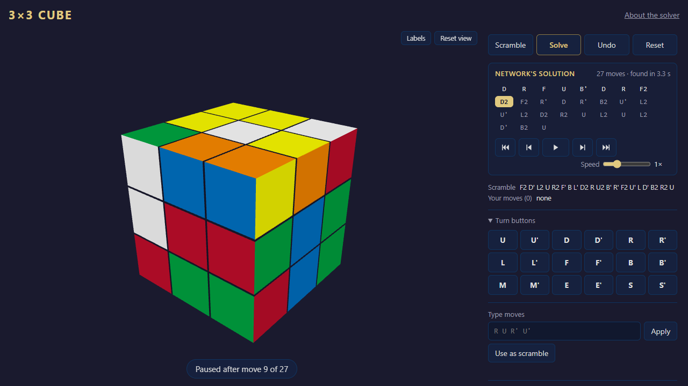

# 3×3 cube with a neural network solver

A 3D cube you can scramble, turn and solve in the browser. The Solve button asks a neural network, trained on random scrambles, for a solution and plays it back. The cube's state is kept in a module separate from the drawing code, so the page, the solver and the tests all share one cube model.

Try it at [joshcc27.github.io/rubiks-cube-solver](https://joshcc27.github.io/rubiks-cube-solver/).



## What works now

- All 18 quarter turns in standard notation: U, D, R, L, F, B, the slice turns M, E, S, and their primes. Directions follow the usual convention (U, R, F clockwise seen from that face; D, L, B clockwise seen from their own side; M follows L, E follows D, S follows F).
- Turning a layer by dragging a sticker. The turn is picked from the drag direction relative to the current camera view, so it works after orbiting to any angle.
- Keyboard turns.
- A 20-move scramble using face turns only, with no two consecutive moves on the same axis. Scramble resets the cube first, so the scramble string plus the move list always describe the state from solved.
- Solve, which runs the trained network in the browser and animates its solution. It works from any state the page can reach, including after slice turns.
- Undo, a move counter and the list of moves made since the scramble, including the solver's.
- Solved detection, which checks that every face shows one colour.

## Controls

| Input | Action |
| --- | --- |
| Drag a sticker | Turn that sticker's layer in the drag direction |
| Drag the background | Orbit the camera |
| Mouse wheel | Zoom |
| `U` `D` `R` `L` `F` `B` `M` `E` `S` | Clockwise turn |
| `Shift` + letter | Counter-clockwise (prime) turn |
| `Ctrl` + `Z` | Undo the last turn |
| Buttons | Single turns, Scramble, Solve, Undo, Reset |

Letter keys are read without regard to case, so Caps Lock does not change the direction. Turns made while another turn is animating are queued. Scramble, Solve and Undo are disabled until the queue is empty. Reset works at any time and clears the queue. Turning the cube, Undo, Scramble or Reset while the solver is searching cancels the search.

## Run locally

The page uses ES modules, so opening `index.html` directly won't work. Serve the folder with any static server instead. From the repository root:

```sh
python -m http.server 8000   # then open http://localhost:8000/
npx serve .                  # needs Node; prints the URL to open
```

There is no build step and nothing to install. Three.js and ONNX Runtime Web are loaded from jsDelivr, so the page needs network access the first time it loads. The first Solve downloads about 11 MB: the network (`models/policy.onnx`, 9 MB) and the ONNX Runtime WebAssembly engine.

## Tests

The cube model and the solver's search have tests that use Node's built-in test runner (Node 18 or newer, no dependencies):

```sh
node --test      # or: npm test
```

They check that:

- any move done four times returns the cube to where it started
- any move followed by its inverse does the same
- `(R U R' U')` done six times is the identity
- a double turn equals two quarter turns
- each turn sends stickers where standard notation says it should (after U, the front top row shows the right face's colour)
- scrambles never turn the same axis twice in a row
- relabelling by centres undoes what slice moves do to the centres, and face turns commute with it
- `training/moves.json` is up to date with `cube-model.js`
- the search, run with a stand-in for the network, solves every two-move state and cubes turned with slice moves, and stops when cancelled

## The neural network solver

**How it learns.** Training scrambles solved cubes with random face turns. Each state along the way is labelled with the move that undoes the turn just made. The network sees the state and learns to predict that move, so its output is a probability for each of the 18 face turns being a step back towards solved. Scrambles are generated on the fly, so there is no dataset. The method follows Takano, *Self-Supervision is All You Need for Solving Rubik's Cube* (2023).

**How it solves.** Always taking the network's top move solves short scrambles but rarely a random cube. Beam search does better: it keeps the 512 move sequences with the highest total probability and extends them one move at a time until one reaches solved. If none does within 60 moves, the page tries again with 2048. On 50 random cubes, a width of 512 solved every one, in about 31 to 33 moves on average. A random cube can usually be solved in about 18, so the network's solutions are valid but long.

**In the page.** The network runs with ONNX Runtime Web on the CPU through WebAssembly, in a Web Worker so the page keeps animating while it searches (`solver-worker.js`). A search takes about 2 to 3 seconds on a laptop. The search itself is in `solver.js` and matches the Python version in `training/src/search.py`.

**Shared moves.** The Python code doesn't define its own moves. `scripts/export-moves.mjs` writes the 18 face-turn permutations from `cube-model.js` to `training/moves.json`, along with example scrambles that the Python tests replay. A Node test fails if the file is out of date, so rerun `npm run export-moves` after changing the model. Slice moves move the centres, so the page passes its state through `relabelByCentres` first. After that, face turns alone can solve it.

### Training

The training code is in `training/`. It uses Python 3.12, PyTorch and [uv](https://docs.astral.sh/uv/). From `training/`:

```sh
uv sync
uv run python -m pytest                       # tests, including a short training run and the ONNX export
uv run python -m src.train --minutes 60       # writes checkpoints/policy.pt
uv run python -m src.evaluate checkpoints/policy.pt --depths 5 10 15 20 100 --widths 1 64 512
uv run python -m src.solve checkpoints/policy.pt "R U R' U' F2 D L"
uv run python -m src.export_onnx checkpoints/policy.pt ../models/policy.onnx   # update the page's network
```

`src.solve` also accepts the page's 54-letter facelet string. `src.train --help` lists the settings: network size, batch size, time or step budget, device and CPU threads. Training picks a CUDA or Intel GPU when PyTorch can see one, and otherwise runs on the CPU. On a CPU with performance and efficiency cores, setting `--threads` to the number of performance cores can be noticeably faster.

The network in `models/policy.onnx` is a fully connected network with four residual blocks (2.3M parameters), trained for one hour on a laptop CPU (38.7M examples). Its ONNX file takes the one-hot colours of the 48 non-centre stickers and returns log-probabilities for the 18 face turns.

## How it is built

- `cube-model.js` holds the logical cube: a 54-entry array of face letters in the order U, R, F, D, L, B, nine stickers per face. For a solved cube `state.join('')` gives the usual facelet string `UUUUUUUUURRRRRRRRRFFFFFFFFFDDDDDDDDDLLLLLLLLLBBBBBBBBB`. Each move is a sticker permutation computed once at load time by rotating sticker positions and normals. The module has no dependency on Three.js, so the page, the tests and the solver all use the same code.
- `main.js` draws the cube with Three.js 0.165, loaded through an import map in `index.html`, and handles input. The 27 small cubes never really move: a turn animates one layer, then snaps it back and recolours the stickers from the model. They all share one geometry and seven materials. Solve sends the state to the worker and queues the solution like any other turns.
- `solver.js` is the beam search, and `solver-worker.js` runs it with the network in a Web Worker.
- `index.html` is the page layout and styles.
- `training/` holds the Python code that trains, evaluates and exports the network.

## Roadmap

- Train for longer, ideally on a GPU, to shorten the solutions.
- Show the solution moves and step through them.
