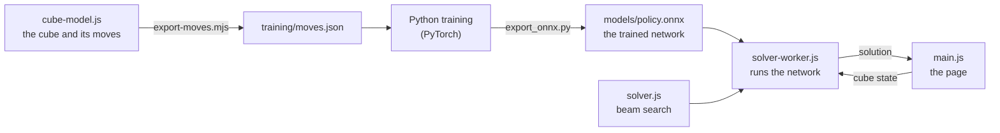

# 3×3 cube with a neural network solver

A 3D cube you can scramble, turn and solve in your browser. The solving is done by a small neural network that taught itself, with no cube-solving rules written by hand. It learned by watching millions of random scrambles and guessing which move would undo each one.

**Try it:** [joshcc27.github.io/rubiks-cube-solver](https://joshcc27.github.io/rubiks-cube-solver/)


## At a glance

- The network has 2.3 million parameters and was trained for one hour on a laptop CPU.
- In tests it solved 100 out of 100 randomly scrambled cubes, using 31 to 33 moves on average.
- It runs entirely in your browser. Nothing is sent to a server.
- The trade-off: its solutions are valid but long. A random cube can usually be solved in 18-20 moves.

This README explains how all of that works, from storing the cube as data, to training the network, to running it in a web page. If you only want to run things, skip to [Running it yourself](#running-it-yourself).

## Contents

- [Using the page](#using-the-page)
- [How it works](#how-it-works)
  1. [The cube as data](#1-the-cube-as-data)
  2. [Teaching a network to undo scrambles](#2-teaching-a-network-to-undo-scrambles)
  3. [Why the network needs a search](#3-why-the-network-needs-a-search)
  4. [Running the network in the browser](#4-running-the-network-in-the-browser)
  5. [Keeping Python and JavaScript in agreement](#5-keeping-python-and-javascript-in-agreement)
  6. [Slice turns and the centres](#6-slice-turns-and-the-centres)
  7. [The page itself](#7-the-page-itself)
- [Results and limitations](#results-and-limitations)
- [Running it yourself](#running-it-yourself)
- [Project layout](#project-layout)
- [Ideas for what's next](#ideas-for-whats-next)
- [Further reading](#further-reading)

## Using the page

Press **Scramble** to mix the cube up, then **Solve**. The network searches for a solution, usually in a few seconds, and then plays it on the cube. While it plays, a panel lists the network's moves. You can pause, step backwards and forwards, click any move to jump to it, or change the playback speed.

You can also turn the cube yourself: drag a sticker, use the keyboard, or open **Turn buttons**. Or type a sequence of moves such as `R U R' U'` into **Type moves**, either to apply it or to use it as your own scramble. **Labels** shows which face is which, and **About the solver** gives a short version of this README.

Moves use standard cube notation. Each letter names a layer: U (up), D (down), R (right), L (left), F (front), B (back), plus the middle layers M, E and S. A letter on its own is a clockwise quarter turn, a `'` makes it counter-clockwise, and a `2` makes it a half turn.

| Input | Action |
| --- | --- |
| Drag a sticker | Turn that sticker's layer in the drag direction |
| Drag the background | Orbit the camera (on a phone: rotate the view) |
| Mouse wheel or pinch | Zoom |
| `U` `D` `R` `L` `F` `B` `M` `E` `S` | Clockwise turn |
| `Shift` + letter | Counter-clockwise turn |
| `Ctrl` + `Z` | Undo the last turn, or step back through a solution |
| `←` `→` | Step back or forward through a solution |
| `Space` | Play or pause a solution |
| `Esc` | Close the help on a phone-sized screen |

A few details that matter if you're poking at it:

- Turns made while another is animating wait in a queue.
- Turning the cube while the solver is searching cancels the search, since the answer would no longer fit the cube. The Solve button reads Stop while it searches, so you can also cancel it directly.
- The page remembers a few settings in your browser: whether the help, labels and turn buttons are shown, and the playback speed.

## How it works

The project has two halves that share one definition of the cube. The Python half in `training/` trains the network. The JavaScript half is the web page, which loads the trained network and uses it to solve whatever is on screen.



The sections below follow that picture from left to right.

### 1. The cube as data

A 3×3 cube has 54 stickers: six faces of nine. The program stores the cube as a list of 54 letters, one per sticker. Each letter names the face whose colour that sticker currently shows. The faces come in the order U, R, F, D, L, B, so a solved cube is:

```text
UUUUUUUUURRRRRRRRRFFFFFFFFFDDDDDDDDDLLLLLLLLLBBBBBBBBB
```

This is the usual "facelet string" format used by cube programs. Laid out flat, the positions are:

```text
              +-----------+
              |  U  0-8   |
  +-----------+-----------+-----------+-----------+
  |  L 36-44  |  F 18-26  |  R  9-17  |  B 45-53  |
  +-----------+-----------+-----------+-----------+
              |  D 27-35  |
              +-----------+
```

A move just rearranges stickers. Turning U, for example, moves the front face's top row to the left face, the right face's top row to the front, and so on round the cube. So every move can be stored as a *permutation*: a list saying where each of the 54 stickers ends up. `cube-model.js` builds these lists once, when it loads. It gives each sticker a 3D position and the direction it faces, rotates both by 90° about the axis of the turn, and looks up which sticker slot they land in. Applying a move is then a single pass over 54 entries.

This module has no drawing code at all. The page, the solver and the tests all use it, and the Python training code gets its moves from it too (see section 5). So there is exactly one definition of what each move does.

### 2. Teaching a network to undo scrambles

The key idea is borrowed from Takano (2023, see [Further reading](#further-reading)). Solving a cube is hard, but scrambling one is easy. And every scramble, read backwards, is a solution.

So the training data is made like this:

1. Start from a solved cube.
2. Make random moves, say `R`, then `U'`, then `F2`.
3. After each move, record the cube and the move that would undo it:

| Cube after | Label (the move that undoes the last one) |
| --- | --- |
| `R` | `R'` |
| `R U'` | `U` |
| `R U' F2` | `F2` |

The network is shown the cube and asked to predict the label. Over many millions of examples it learns, for any cube, how likely each of the 18 face turns is to be a step back towards solved.

There is no dataset on disk. Every training batch is made fresh: 256 random scrambles of 26 moves each, giving 6,656 examples per step. The scrambles never turn the same face twice in a row, and only allow one order for turns of opposite faces (`U` then `D`, never `D` then `U`, since the two orders give the same cube). Without those rules the network would see lots of pointless sequences.

**What the network sees.** The cube is turned into 288 numbers. For each of the 48 stickers that can move, six numbers say which colour it shows: a 1 for its colour and 0 for the rest. The six centre stickers are left out, because face turns never move them, so they carry no information.

**What it is.** A plain fully connected network. It goes from 288 inputs to 512 units, then through four residual blocks of 512 units, then to 18 outputs, one score per move. A softmax turns the scores into probabilities. That's 2.3 million parameters in total.

**How it trained.** One hour on a laptop CPU with the AdamW optimiser. The learning rate started at 0.001 and decayed to zero over the hour. The run took 5,820 steps and 38.7 million examples.

**How often its first choice matches the label** depends heavily on how scrambled the cube is:

| Moves from solved | 1 | 3 | 5 | 8 | 12 | 16 | 20 |
| --- | --- | --- | --- | --- | --- | --- | --- |
| Top guess matches the label | 100% | 100% | 97% | 60% | 24% | 12% | 8% |

The low numbers on the right don't mean the network is failing. Deep into a scramble, many different moves are equally good next steps, and the label names only one of them. The network learns the whole spread of good moves, and the search in the next section uses that.

### 3. Why the network needs a search

The obvious way to use the network is to always make the move it rates highest. That works for short scrambles and then falls apart. Each wrong guess leaves the cube in a state the network understands a little less well, and the errors compound.

*Beam search* fixes that by keeping several possibilities open at once:

1. Start with one candidate: the scrambled cube, with no moves made yet.
2. Ask the network for its move probabilities from every candidate.
3. Extend every candidate by every allowed move (the same rules as the scrambles: no face twice in a row, and one order for opposite faces). Each new sequence is scored by how confident the network was at every step along the way: the probabilities multiplied together, or in practice their logarithms added up.
4. If any new cube is solved, stop. That sequence is the answer.
5. Otherwise keep the best 512 sequences, dropping duplicates that reach the same cube by different routes, and go back to step 2.

The number of sequences kept is called the *beam width*. Width 1 is the "always take the top move" approach. Wider beams cost more network evaluations but recover from the network's mistakes.

Here's what that looks like in practice, with 50 cubes per row:

| Scramble length | Width 1 | Width 64 | Width 512 |
| --- | --- | --- | --- |
| 5 moves | 78% solved | 100%, 5.1 moves | 100%, 5.0 moves |
| 10 moves | 8% | 94%, 16.9 moves | 100%, 13.1 moves |
| 15 moves | 0% | 64%, 39.5 moves | 100%, 28.9 moves |
| 20 moves | 0% | 66%, 38.2 moves | 98%, 31.1 moves |
| Random cube (100 moves) | 0% | 60%, 42.0 moves | 100%, 31.1 moves |

And on random cubes, from a separate run:

| Beam width | 128 | 256 | 512 | 1024 |
| --- | --- | --- | --- | --- |
| Solved | 88% | 96% | 100% | 100% |
| Average solution | 38.7 moves | 35.2 moves | 33.0 moves | 29.6 moves |
| Time per cube (Python, laptop CPU) | 0.21 s | 0.27 s | 0.66 s | 0.80 s |

Wider beams solve more cubes and also find shorter solutions, because they explore more routes. The page uses width 512. If that finds nothing within 60 moves, it tries again with 2048.

### 4. Running the network in the browser

Once trained, the network is exported to [ONNX](https://onnx.ai/), a standard file format for neural networks. In the file the network is nothing more than a few matrix multiplications, additions and a softmax, 9 MB of numbers in all. The export script then checks that the file gives the same answers as PyTorch, to within 0.000001.

In the page, [ONNX Runtime Web](https://onnxruntime.ai/docs/tutorials/web/) runs that file on your CPU through WebAssembly. The beam search itself is ordinary JavaScript in `solver.js`, and it follows the same steps as the Python version in `training/src/search.py`. Both run inside a *Web Worker*, a background thread, so the cube keeps animating and the buttons keep responding while the search runs.

A few practical details:

- **Speed.** A search takes about 2 to 3 seconds on a laptop that's plugged in. It's slower on battery or on a phone.
- **One thread.** WebAssembly can only use several threads on a "cross-origin isolated" page, which needs special server headers that GitHub Pages can't send.
- **First download.** The network and the runtime are about 12 MB together and are only downloaded on the first Solve. The status line shows the download's progress.
- **Cancelling.** If you change the cube during a search, the page tells the worker to stop and ignores anything it sends back for the old cube.

### 5. Keeping Python and JavaScript in agreement

The network is trained in Python but used in JavaScript, so both sides must agree exactly on what every move does. They must also agree on how a cube is turned into the network's 288 inputs. If one move differed, the network would quietly learn the wrong thing, and nothing would crash to warn you.

So the Python code never defines moves itself. `scripts/export-moves.mjs` runs the JavaScript cube model and writes every move's permutation to `training/moves.json`, along with sample scrambles and the cubes they produce. The Python tests replay those samples and check they get the same cubes. A Node test fails if `moves.json` is out of date, so a change to the model can't slip through unnoticed. After changing the model, run `npm run export-moves`.

### 6. Slice turns and the centres

The middle-layer turns M, E and S are different from face turns: they move the centre stickers. The network only ever saw cubes with the centres in their home positions, so a cube after `M` looks like nothing it was trained on.

The fix is to rename the colours. After `M`, the up face's centre shows the back face's colour. If you rename every back-coloured sticker as "up", and do the same for the other faces, the centres are home again and the cube is one the network understands. That's what `relabelByCentres` does.

This works because the renaming only changes the names of colours, not where stickers are, and face turns move stickers without caring what they're called. So any face-turn solution for the renamed cube also solves the real one. For example, once renamed, `M` looks exactly like `R L'`, two face turns the network can undo. The tests check this for all three slice turns.

### 7. The page itself

**Drawing the cube.** The cube is drawn with [Three.js](https://threejs.org/) as 27 small cubes. Surprisingly, those small cubes never actually move. A turn animates one layer rotating by 90°, then snaps it back to where it started and repaints the stickers from the cube model. This keeps the drawing in sync with the model, because there's only ever one source of truth.

**Drag to turn.** To pick a turn from a drag, the page imagines turning the touched sticker about each possible axis. It works out which way the sticker would move on screen and picks the turn that best matches the direction you dragged. That's why dragging works from any camera angle.

**Remembering how the cube got here.** `session.js` holds the cube on screen and a record of how it got there: the scramble, the moves since, and the part of the network's solution already played. The record always explains the cube exactly:

```text
cube on screen = solved cube + scramble + moves since + solution moves played so far
```

Undo, stepping, jumping and putting a solution away are all defined in terms of that record, and its Node tests check the equation holds after each of them. This file has no drawing code, which is what makes it easy to test.

**The solution player.** The player feeds the solution into the same turn queue as your own moves, one move at a time, so pausing takes effect after the current move. Jumping to a move skips the animation and recomputes the cube from the record instead.

## Results and limitations

What works well:

- **It solves.** 100 of 100 random cubes in two test runs, with every reported solution replayed to confirm it really solves the cube.
- **It's cheap.** One hour of laptop CPU training, a 9 MB network, and a few seconds per solve in a browser.
- **It's honest about its moves.** The page shows the network's own solution, not a hidden standard solver.

What doesn't, yet:

- **The solutions are long.** They average 31 to 33 moves. Most random cubes need 18, and none needs more than 20.
- **The network alone is weak.** Without the search it can't get past about 10 moves. Width 512 does a lot of the work.
- **It's undertrained.** 38.7 million examples is small for this task, and the training loss was still going down when the hour ran out. Published versions train for far longer on GPUs and come much closer to the shortest solutions.
- **It only solves cubes the page can reach.** There's no way to type in a real cube's colours yet.

## Running it yourself

### The page

The page uses JavaScript modules, which browsers won't load from a file opened directly. So serve the folder with any static web server. From the repository root:

```sh
python -m http.server 8000   # then open http://localhost:8000/
npx serve .                  # needs Node; prints the URL to open
```

There's no build step and nothing to install. Three.js and ONNX Runtime Web load from the jsDelivr CDN, so the page needs network access the first time.

### Tests

```sh
node --test                      # JavaScript tests, Node 18 or newer, no dependencies
cd training && uv run python -m pytest   # Python tests
```

The JavaScript tests check that:

- Every move behaves like the real puzzle. Any move four times is no change, a move followed by its inverse is no change, and `R U R' U'` six times returns to the start.
- Each move sends stickers where standard notation says it should.
- Slice turns are handled correctly by relabelling.
- Typed moves are read correctly, with or without spaces.
- `moves.json` is up to date.
- The beam search, run with a stand-in for the network, finds every two-move solution and stops when cancelled.
- The page's move record always explains the cube on screen.

The Python tests check:

- Training labels really do undo the last scramble move.
- Python's moves match the JavaScript ones.
- The exported ONNX file matches PyTorch.
- A short real training run learns to undo 3-move scrambles.

### Training your own network

The training code uses Python 3.12, PyTorch and [uv](https://docs.astral.sh/uv/). From `training/`:

```sh
uv sync                                        # install everything
uv run python -m src.train --minutes 60        # train; writes checkpoints/policy.pt
uv run python -m src.evaluate checkpoints/policy.pt --depths 5 10 15 20 100 --widths 1 64 512
uv run python -m src.solve checkpoints/policy.pt "R U R' U' F2 D L"
uv run python -m src.export_onnx checkpoints/policy.pt ../models/policy.onnx   # use it in the page
```

Some tips:

- `src.train --help` lists the settings: network size, batch size, time or step budget, device and CPU threads.
- Training uses a CUDA or Intel GPU if PyTorch can see one, and otherwise the CPU. On a CPU with separate performance and efficiency cores, try `--threads` set to the number of performance cores. On the laptop used here, 6 threads was about 50% faster than the default.
- `src.solve` accepts scrambles typed the same way as on the page, slice turns included, or a 54-letter facelet string copied from the page. It gives a clear error for anything it can't read.
- `src.evaluate` reports, for each scramble length and beam width, how many cubes were solved, how long the solutions were and how long the search took. It produced the tables above.

## Project layout

```text
index.html               page layout and styles
main.js                  draws the cube, handles input, plays solutions, talks to the worker
cube-model.js            the cube: stickers, moves, notation, relabelling
session.js               the cube on screen and the record of how it got there
solver.js                beam search, with no network code in it
solver-worker.js         loads the network with ONNX Runtime Web and runs the search
models/policy.onnx       the trained network (9 MB)
scripts/export-moves.mjs writes training/moves.json from cube-model.js
tests/                   Node tests
training/
  moves.json             every move, exported from cube-model.js
  src/cube.py            the cube in PyTorch, many cubes at once
  src/model.py           the network
  src/train.py           the training loop
  src/search.py          beam search in Python
  src/evaluate.py        solve rates and solution lengths
  src/solve.py           solve one cube from the command line
  src/facelets.py        reads typed moves and facelet strings like the page does
  src/export_onnx.py     writes models/policy.onnx
  tests/                 Python tests
```

## Ideas for what's next

- **Train for longer**, ideally on a GPU. This is the most direct way to shorten the solutions.
- **Use the cube's symmetries.** Rotating or mirroring a cube gives up to 48 equivalent training examples for the price of one.
- **Learn how far from solved a cube is**, not just which move to make, and use it to guide the search. This is the approach DeepCubeA takes.
- **Enter a real cube's colours** and solve it. That needs checks that the colours describe a cube that can actually exist.

## Further reading

- Kyo Takano, *Self-Supervision is All You Need for Solving Rubik's Cube*, Transactions on Machine Learning Research, 2023. The training method used here: learn to undo random scrambles, then search with beam search.
- Forest Agostinelli, Stephen McAleer, Alexander Shmakov and Pierre Baldi, *Solving the Rubik's cube with deep reinforcement learning and search*, Nature Machine Intelligence, 2019. DeepCubeA, which learns how many moves a cube is from solved and searches with that estimate instead.
